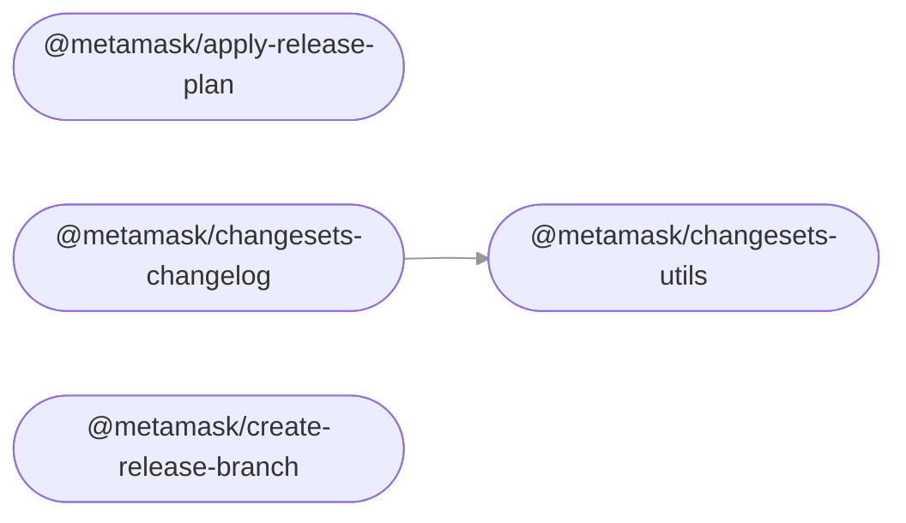

# MetaMask Release Tools

<table><tr><td>
<b>⚠️ PLEASE READ ⚠️</b>

This package is currently being migrated to our <a href="https://github.com/MetaMask/release-tools"><code>release-tools</code></a> monorepo. Please do not make any commits to this repository while this migration is taking place, as they will not be transferred over. Also, please re-open PRs that are under active development in the <a href="https://github.com/MetaMask/release-tools"><code>release-tools</code></a> repo.
</td></tr></table>

Tools for releasing MetaMask packages.

## Contributing

See the [Contributor Documentation](./docs) for help on:

- Setting up your development environment
- Working with the monorepo
- Testing changes to a package in other projects
- Issuing new releases
- Creating a new package

## Packages

<!-- start package list -->

- [`@metamask/apply-release-plan`](packages/apply-release-plan)
- [`@metamask/changesets-changelog`](packages/changesets-changelog)
- [`@metamask/changesets-utils`](packages/changesets-utils)
- [`@metamask/create-release-branch`](packages/create-release-branch)

<!-- end package list -->

<!-- start dependency graph -->

<!-- end dependency graph -->

(This section may be regenerated at any time by running `yarn readme-content:update`.)
