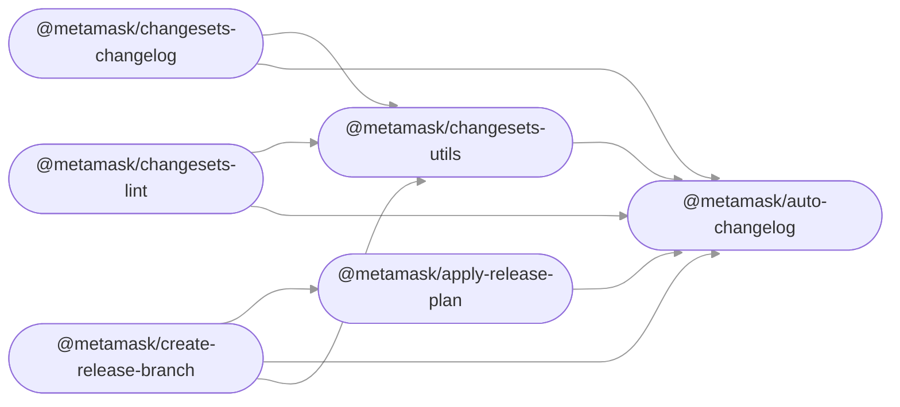

# MetaMask Release Tools

Tools for releasing MetaMask packages.

## Contributing

See the [Contributor Documentation](./docs) for help on:

- Setting up your development environment
- Working with the monorepo
- Testing changes to a package in other projects
- Issuing new releases
- Creating a new package

## Packages

<!-- start package list -->

- [`@metamask/apply-release-plan`](packages/apply-release-plan)
- [`@metamask/auto-changelog`](packages/auto-changelog)
- [`@metamask/changesets-changelog`](packages/changesets-changelog)
- [`@metamask/changesets-lint`](packages/changesets-lint)
- [`@metamask/changesets-utils`](packages/changesets-utils)
- [`@metamask/create-release-branch`](packages/create-release-branch)

<!-- end package list -->

<!-- start dependency graph -->

<!-- end dependency graph -->

(This section may be regenerated at any time by running `yarn readme-content:update`.)
